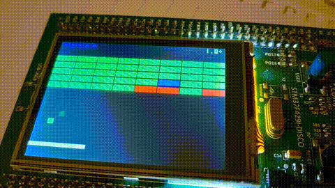

# Gyro Breakout in Rust



A dependency-free, bare-metal Breakout game for the **STM32F429I-DISCO** (STM32F429ZI). It uses the onboard LCD, touchscreen, gyroscope, blue user button, and ST-LINK, with register-level hardware drivers and startup.

## Play

At startup, a particle animation compares CPU and DMA2D drawing. It alternates methods every three seconds and displays their most recent frame rates in a reserved top bar: CPU on the left and DMA2D on the right. The active method is yellow. Both modes clear the same animation area and draw 96 particles, with the same CPU-drawn numbers and frame handling. These figures measure rendering throughput, including waiting for DMA transfers, rather than the LCD refresh rate. Press and release the blue button to continue to the fractals. If DMA2D fails, the right-hand reading shows red `0000` and CPU drawing continues.

Mandelbrot, Julia, Koch snowflake, and fern fractals are then displayed from temporary framebuffers in external SDRAM. Press and release the blue user button to advance to the next fractal, then to calibration after the fern. The startup animation and fractals are skipped if the SDRAM initialization or basic memory check fails.

On any fractal, tap a point to zoom in 2× around it. Release before tapping again. Mandelbrot and Julia support 14 zooms; the snowflake and fern support three (up to 8×) to limit rendering time. The snowflake adds finer segments and the fern generates more points as you zoom, so deeper views can take longer to render. Touch uses the STMPE811 controller and the standard DISCO panel calibration; touch coordinates can vary between board revisions. If the controller is unavailable, the blue button still advances normally.

Keep the board flat and still during calibration. Rotate it to move the paddle; press the blue button to launch, then press or hold it to fire. A quick rotation on the other axis changes speed in 0.1× steps between 0.5× and 1.3×; return the board to rest between gestures. Bricks take two hits, turning red after the first. Destroying the blue bonus brick with the ball gives two extra lives; shots do not. Clear the bricks to win. Release and press the button after a result to restart, then press again to launch.

Ball impacts on bricks show a brief glass-shatter effect.

The paddle accelerates and slows gradually as you rotate the board, and continues briefly after you return it to rest.

When the last ball falls, an orange marker appears briefly at the bottom of the screen while the next life begins.

Hold the blue button when calibration finishes to enter automatic simulation. It plays repeated rounds, while the physical button controls firing and rotation gestures adjust speed. Reset the board to return to normal play.

In simulation, the paddle also tries to catch falling power-ups when it can do so while protecting an approaching ball.

White bricks are indestructible: the ball bounces off them and shots disappear on impact. Each column has at most one, and columns containing them are separated by at least one column. Only destructible bricks count toward winning.

Each round has one yellow bomb brick. A ball or shot detonates it, destroying up to two adjacent destructible bricks, including diagonal neighbors. The blast checks neighbors from top to bottom, left to right. White bricks are unaffected; a bonus brick destroyed by the blast does not award extra lives.

Some destroyed bricks drop a yellow power-up. Catch it with the paddle to widen it for 10 seconds; the yellow W timer shows the remaining time. Catching another refreshes the timer, and losing a life ends the effect.

Catch a cyan power-up to split the ball into three. A life is lost only when all balls fall; another cyan pickup restores missing balls, up to three total.

Catch a magenta power-up to make all balls pierce destructible bricks for 10 seconds. Each ball damages a brick once per pass; white bricks still reflect balls. The magenta P timer shows the remaining time. Another pickup refreshes the timer, and losing a life ends the effect.

The result screen stays visible for at least three seconds and shows the current round time and position in yellow alongside the five fastest winning times. Wins outside the top five show rank 5+; unfinished rounds show no rank. The current time is also highlighted if it enters the top five. Times include waiting to launch and are kept in RAM, so they reset when the board resets; simulation wins are included.

## Build and flash

The reference toolchain is **Rust 1.100.0** (`rustc 1.100.0`, Cargo 1.100.0). Install the `thumbv7em-none-eabihf` target, GNU Make, and `arm-none-eabi-size`. Flashing also requires OpenOCD with the STM32F429 Discovery board configuration and the board's ST-LINK USB port.

```sh
rustup target add thumbv7em-none-eabihf
make test     # host gameplay tests
make check    # tests, formatting, and release cross-build
make          # clean, build release firmware, then flash
make build    # same as make release
make debug    # debug firmware with symbols and runtime checks
make flash    # build release, then program, verify, and reset with OpenOCD
```

`make` cleans the build output, builds the release firmware, and flashes the board. Use `make build` to build without flashing. The linker script allocates 2 MiB of flash and 192 KiB of contiguous main SRAM, with an 8 KiB stack region in internal CCM RAM. The clock setup expects an 8 MHz HSE crystal in oscillator mode. A board configured for an external clock bypass requires a clock setup change. The single framebuffer can tear because updates are not synchronized to display refresh. A red LED indicates a startup, sensor, timer, or panic fault.

Both firmware builds print their section sizes. In that output, `text` and `data` occupy flash, while `data` and `bss` occupy RAM; `bss` includes the framebuffer.

Release build size:

```text
arm-none-eabi-size target/thumbv7em-none-eabihf/release/gyro-breakout
   text    data     bss     dec     hex filename
  22248       0  153600  175848   2aee8 target/thumbv7em-none-eabihf/release/gyro-breakout
```

## Verification and limitations

A clean build, flash, and game test have succeeded on physical STM32F429I-DISCO hardware, including touchscreen zoom on all four fractals, the particle benchmark with DMA2D, and the revised frame-rate display. Host tests exercise game rules, not peripheral behavior, and cross-compilation alone does not verify the clock, display, gyro, timing, or flash programming.

The game and renderer are `no_std` library modules. `src/game.rs` owns game state and rules, with ball collisions in `src/game/physics.rs` and power-ups in `src/game/power_up.rs`; `src/board.rs` contains the F429 register-level drivers. No allocator or external crates are used. The framebuffer occupies about 150 KiB of SRAM.

## Memory use

The current release build uses the following memory on the STM32F429I-DISCO:

| Memory | Capacity | Used or reserved |
| --- | ---: | --- |
| Main internal SRAM | 192 KiB | 150 KiB static data |
| Internal CCM RAM | 64 KiB | 8 KiB reserved for the stack |
| External SDRAM | 8 MiB | 300 KiB startup framebuffers |
| Internal flash | 2 MiB | 22,248 bytes |

The 320 × 240 RGB565 game framebuffer accounts for all 153,600 bytes of static main SRAM, leaving 42 KiB unallocated. Two separate 153,600-byte framebuffers in external SDRAM are reused for the startup images; gameplay returns to the internal framebuffer. The stack occupies a reserved 8 KiB region in CCM; 56 KiB of CCM remains unallocated. Actual stack usage, including game state and temporary values, has not been measured on the board. No heap allocator is used. CCM is accessible to CPU but not the LCD controller, so neither framebuffer is placed there.

The `dec` column in the size output adds flash and static RAM sections; it is not the RAM usage alone.


## License

MIT; see [LICENSE](LICENSE).
